# GALLERY — витрина архива референсов студии «Студия мини-приложений»

Снимки собраны командой `node scripts/render_reference_screenshots.mjs` из meta.yaml:
палитра и приёмы референса → образец дизайна → PNG. Образец лежит рядом (`<id>.specimen.html`).

## ref-01 · one-screen

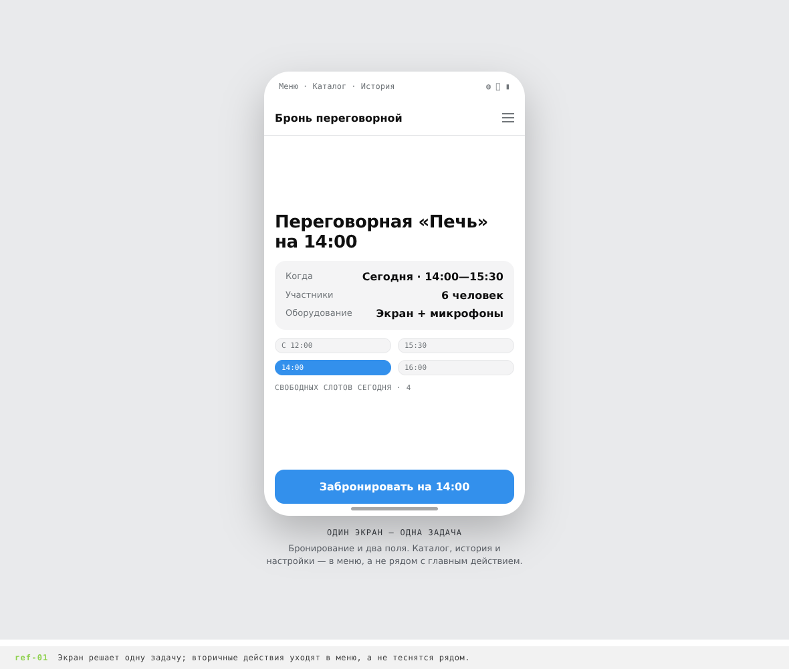

- takeaway: Экран решает одну задачу; вторичные действия уходят в меню, а не теснятся рядом.
- источник: references/sources.yaml#single-page-app
- архетип образца: `tma-one-screen`
- образец: [ref-01.specimen.html](metadata/ref-01.specimen.html)

## ref-02 · instant-feedback

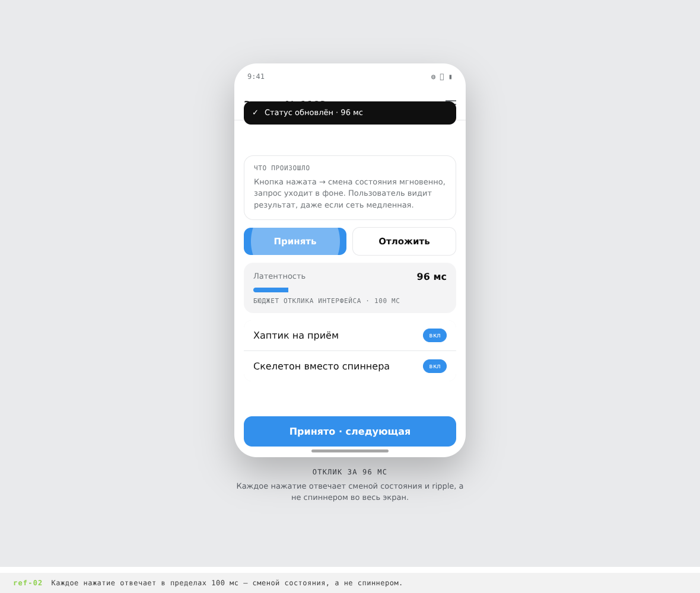

- takeaway: Каждое нажатие отвечает в пределах 100 мс — сменой состояния, а не спиннером.
- источник: references/sources.yaml#single-page-app
- архетип образца: `tma-instant-feedback`
- образец: [ref-02.specimen.html](metadata/ref-02.specimen.html)

## ref-03 · focus-visible

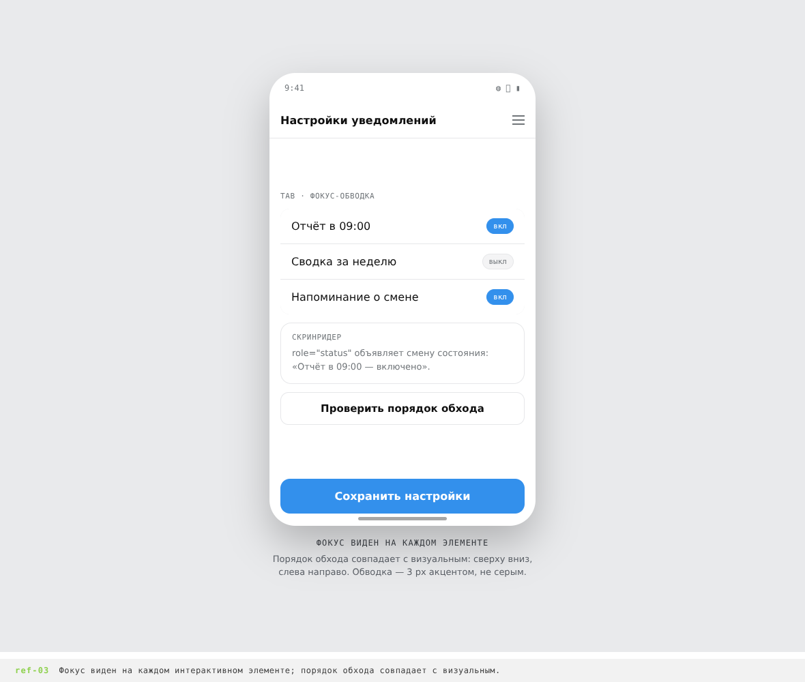

- takeaway: Фокус виден на каждом интерактивном элементе; порядок обхода совпадает с визуальным.
- источник: references/sources.yaml#a11y-pass
- архетип образца: `tma-focus-visible`
- образец: [ref-03.specimen.html](metadata/ref-03.specimen.html)

## ref-04 · invoice-initdata

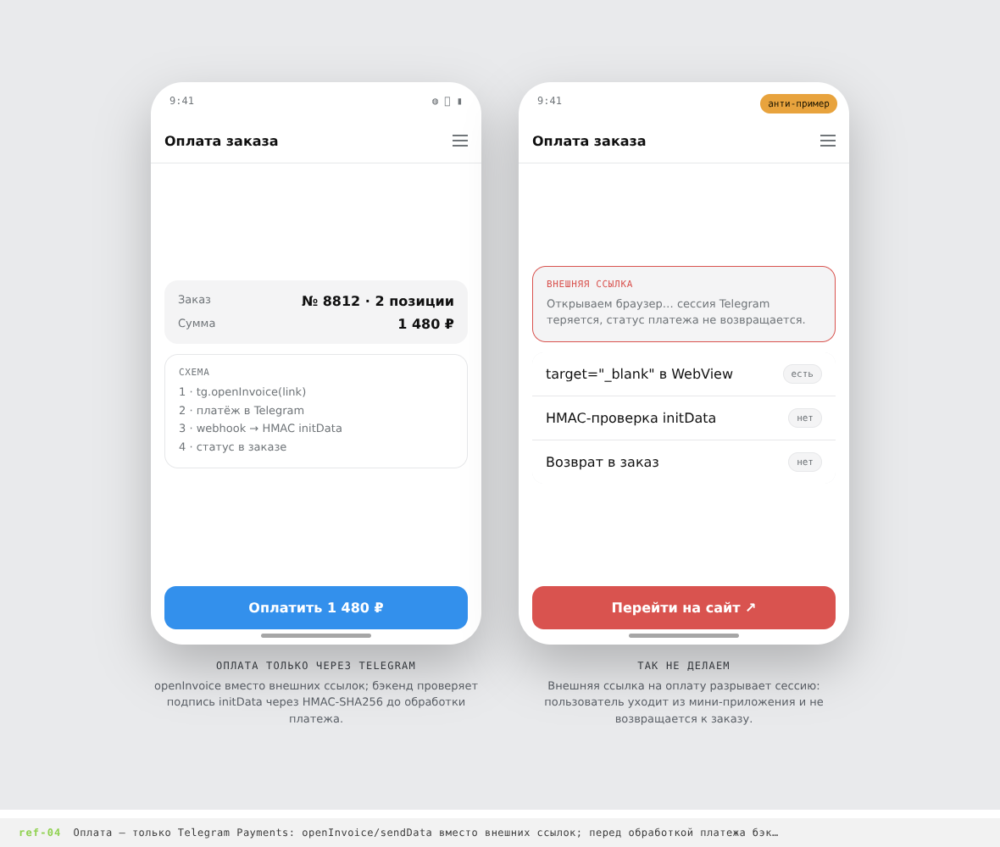

- takeaway: Оплата — только Telegram Payments: openInvoice/sendData вместо внешних ссылок; перед обработкой платежа бэкенд проверяет подпись initData через HMAC-SHA256.
- источник: references/sources.yaml#payments
- архетип образца: `tma-invoice`
- образец: [ref-04.specimen.html](metadata/ref-04.specimen.html)

## ref-05 · viewport-safearea

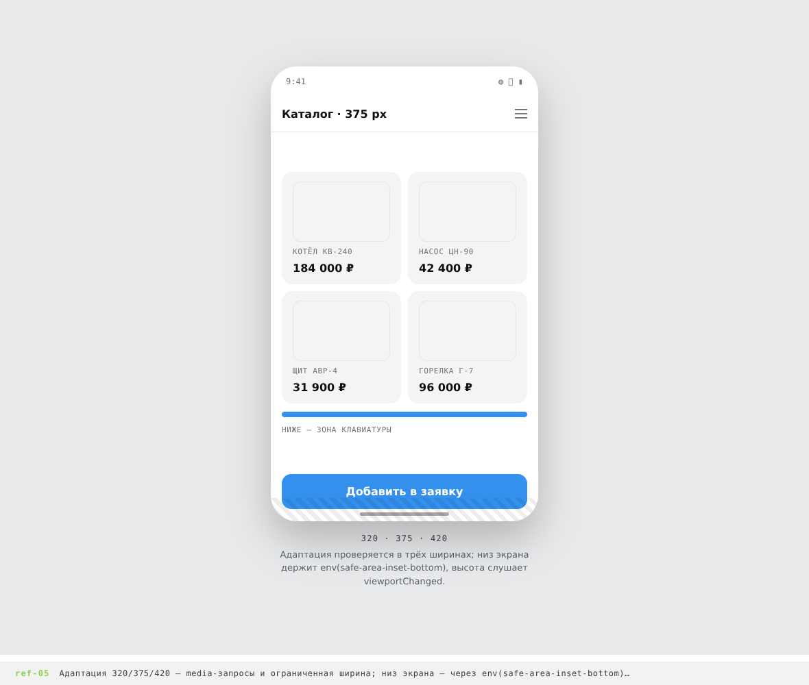

- takeaway: Адаптация 320/375/420 — media-запросы и ограниченная ширина; низ экрана — через env(safe-area-inset-bottom), высота — через viewportChanged, а не жёсткий 100vh.
- источник: references/sources.yaml#viewport-adaptive
- архетип образца: `tma-viewport-safe`
- образец: [ref-05.specimen.html](metadata/ref-05.specimen.html)

## ref-06 · offline-sw

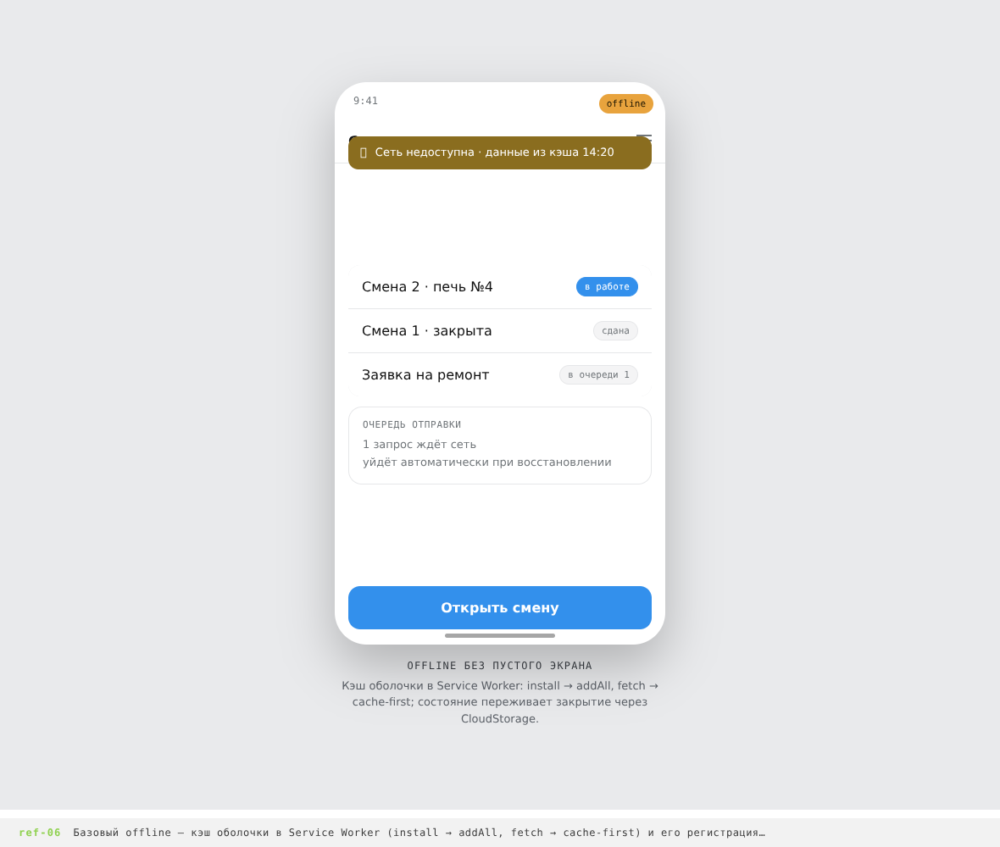

- takeaway: Базовый offline — кэш оболочки в Service Worker (install → addAll, fetch → cache-first) и его регистрация; состояние переживает закрытие через CloudStorage/sendData.
- источник: references/sources.yaml#offline-worker
- архетип образца: `tma-offline-sw`
- образец: [ref-06.specimen.html](metadata/ref-06.specimen.html)

## ref-07 · tma-entry

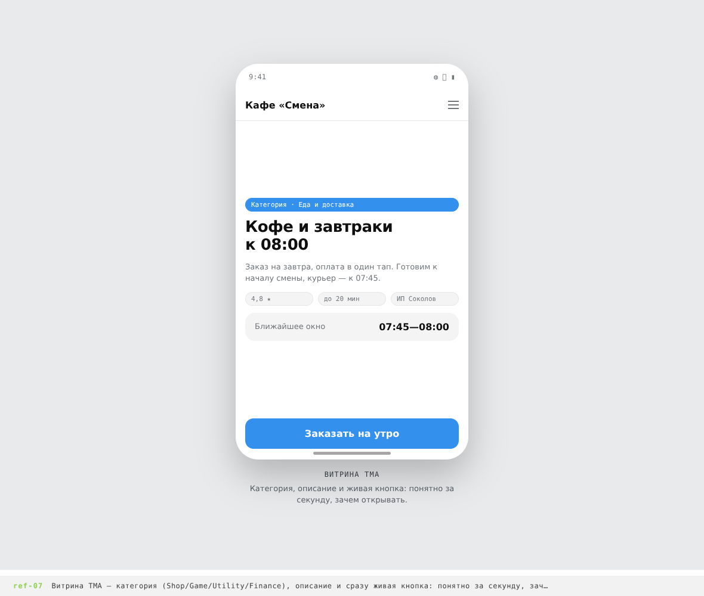

- takeaway: Витрина TMA — категория (Shop/Game/Utility/Finance), описание и сразу живая кнопка: понятно за секунду, зачем открывать.
- источник: references/sources.yaml#tma-gallery
- архетип образца: `tma-storefront`
- образец: [ref-07.specimen.html](metadata/ref-07.specimen.html)

## ref-08 · tma-review

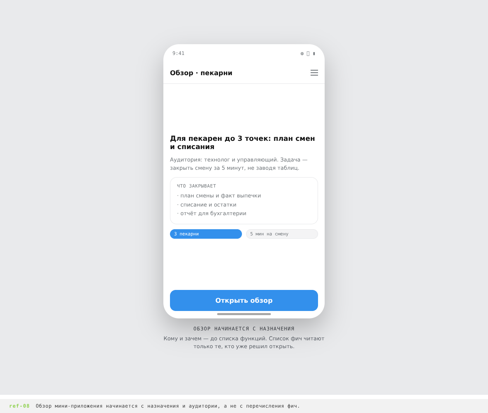

- takeaway: Обзор мини-приложения начинается с назначения и аудитории, а не с перечисления фич.
- источник: references/sources.yaml#miniapp-cafe
- архетип образца: `tma-review`
- образец: [ref-08.specimen.html](metadata/ref-08.specimen.html)

## ref-09 · tma-niche-charts

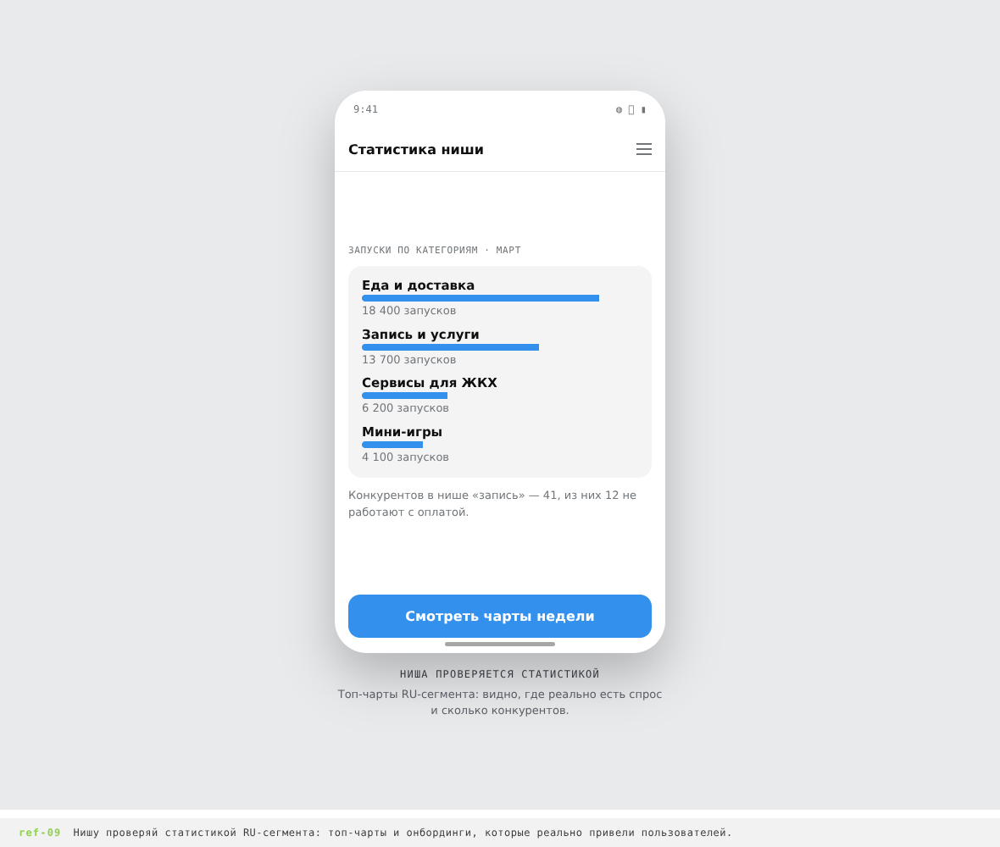

- takeaway: Нишу проверяй статистикой RU-сегмента: топ-чарты и онбординги, которые реально привели пользователей.
- источник: references/sources.yaml#tgstat
- архетип образца: `tma-charts`
- образец: [ref-09.specimen.html](metadata/ref-09.specimen.html)

## ref-10 · tma-ui-concept

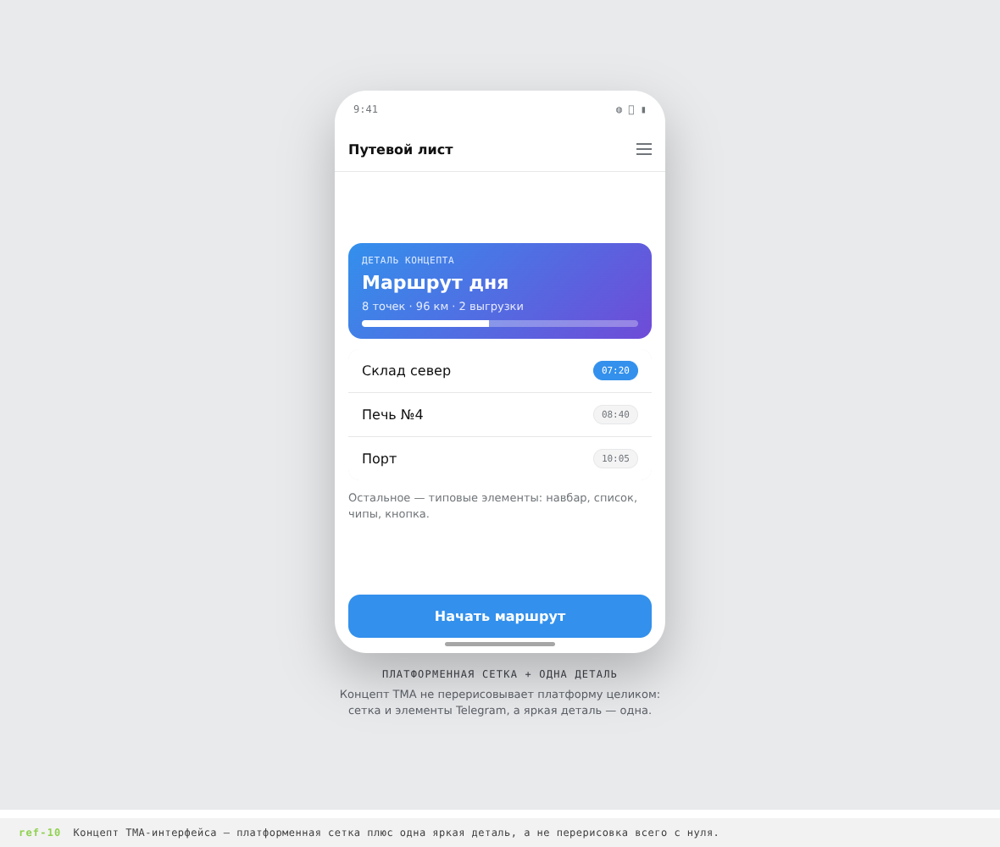

- takeaway: Концепт TMA-интерфейса — платформенная сетка плюс одна яркая деталь, а не перерисовка всего с нуля.
- источник: references/sources.yaml#dribbble-tma
- архетип образца: `tma-concept`
- образец: [ref-10.specimen.html](metadata/ref-10.specimen.html)

## ref-11 · tma-case

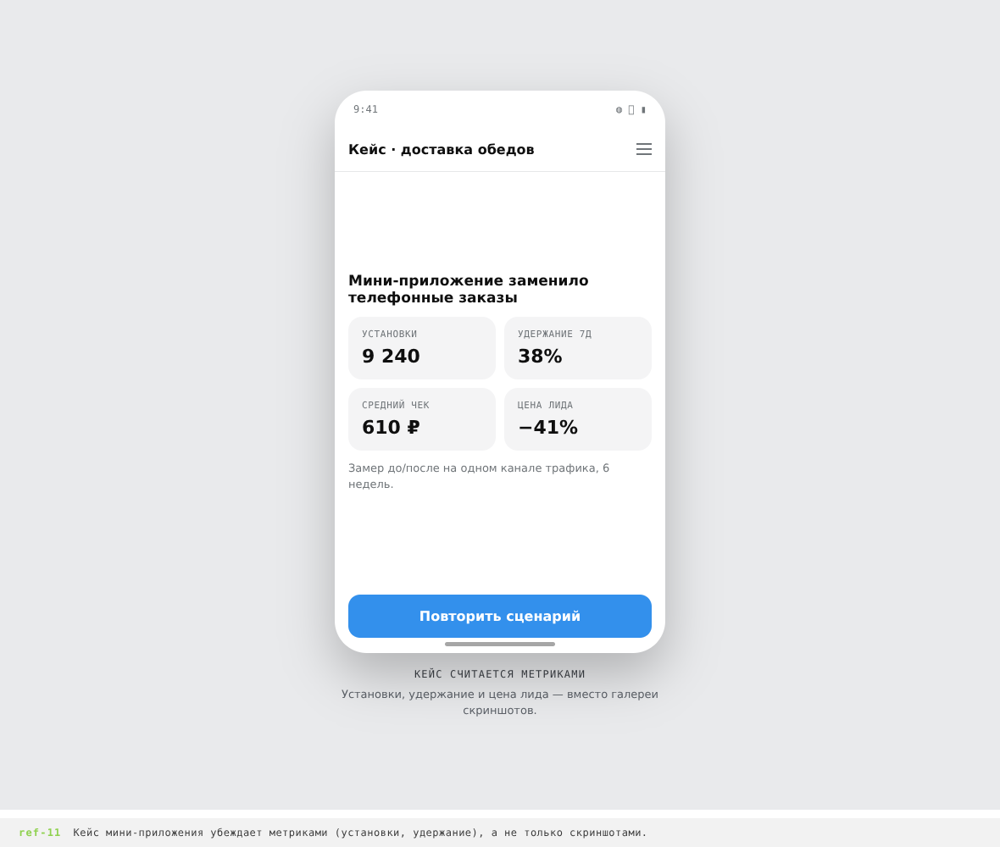

- takeaway: Кейс мини-приложения убеждает метриками (установки, удержание), а не только скриншотами.
- источник: references/sources.yaml#behance-tma
- архетип образца: `tma-case`
- образец: [ref-11.specimen.html](metadata/ref-11.specimen.html)

## ref-12 · contrast-ratio

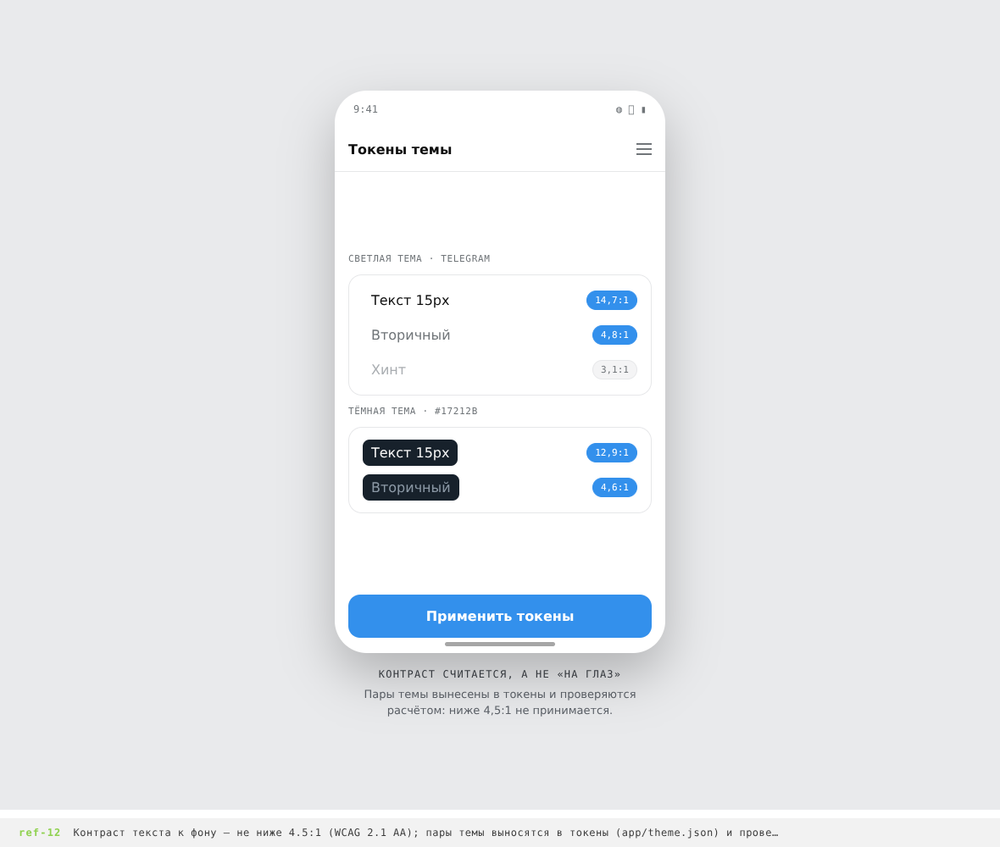

- takeaway: Контраст текста к фону — не ниже 4.5:1 (WCAG 2.1 AA); пары темы выносятся в токены (app/theme.json) и проверяются расчётом, а не глазами.
- источник: references/sources.yaml#a11y-pass
- архетип образца: `tma-contrast`
- образец: [ref-12.specimen.html](metadata/ref-12.specimen.html)

## ref-13 · usability-heuristics

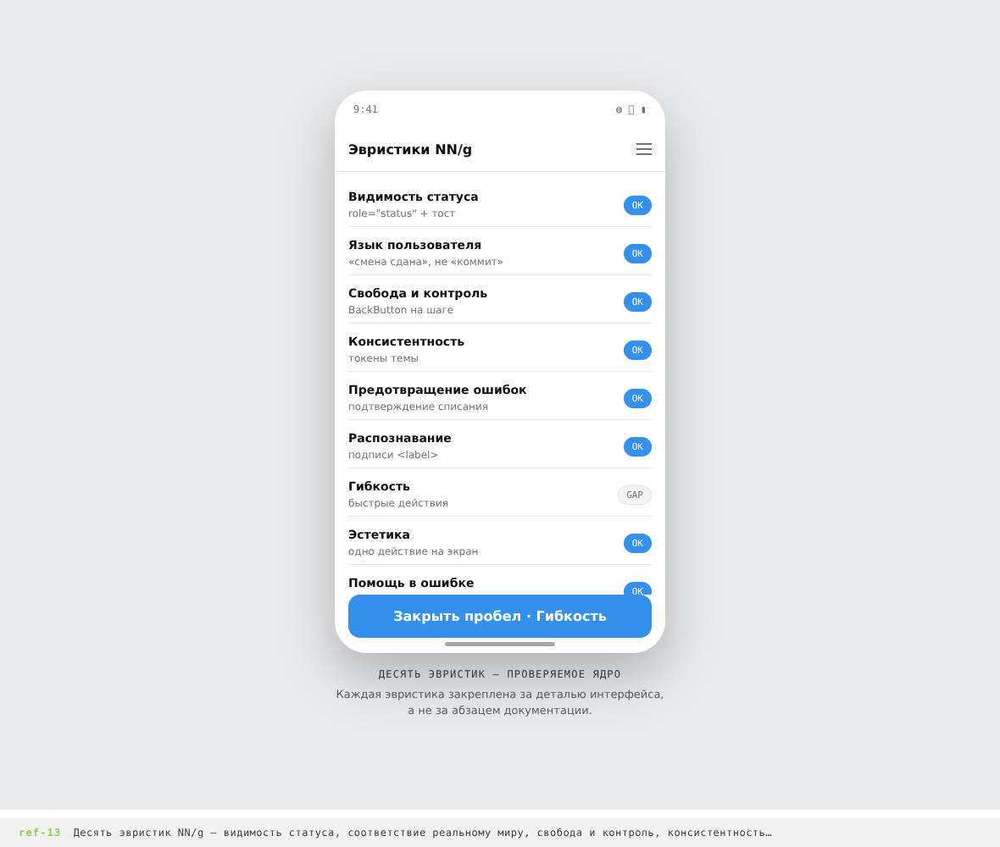

- takeaway: Десять эвристик NN/g — видимость статуса, соответствие реальному миру, свобода и контроль, консистентность, предотвращение ошибок, распознавание вместо припоминания, гибкость, эстетика, восстановление после ошибки, справка; проверяемое ядро (статус/выход/подписи/отклик/справка) машинизируется прокси-сканом V-22.
- источник: references/sources.yaml#nng-heuristics
- архетип образца: `tma-heuristics`
- образец: [ref-13.specimen.html](metadata/ref-13.specimen.html)

## ref-14 · usability-cra

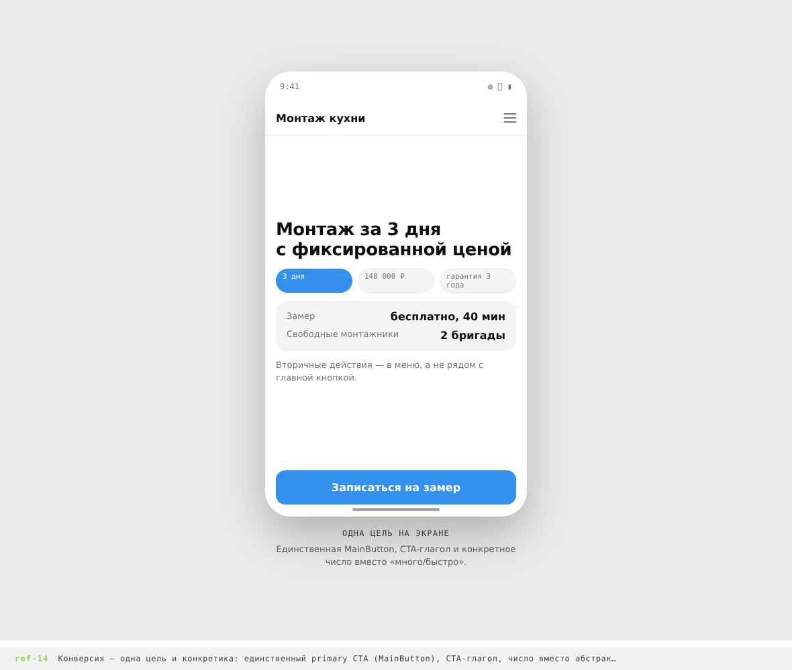

- takeaway: Конверсия — одна цель и конкретика: единственный primary CTA (MainButton), CTA-глагол, число вместо абстракций (исследования CTA-форм, baymard.com); проверяемое ядро машинизируется прокси-сканом V-23.
- источник: references/sources.yaml#baymard-cta
- архетип образца: `tma-cta`
- образец: [ref-14.specimen.html](metadata/ref-14.specimen.html)

## ref-15 · motion-pass

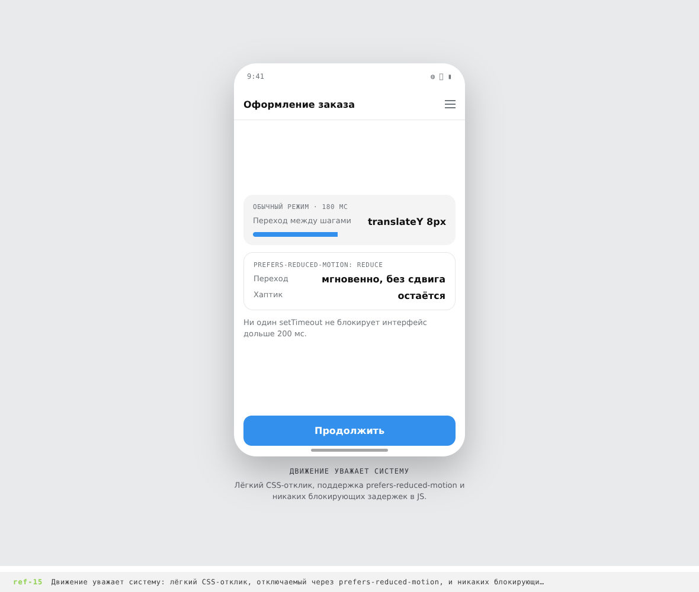

- takeaway: Движение уважает систему: лёгкий CSS-отклик, отключаемый через prefers-reduced-motion, и никаких блокирующих задержек в JS (V-24).
- источник: references/sources.yaml#wm-3
- архетип образца: `tma-motion`
- образец: [ref-15.specimen.html](metadata/ref-15.specimen.html)

## ref-16 · human-voice

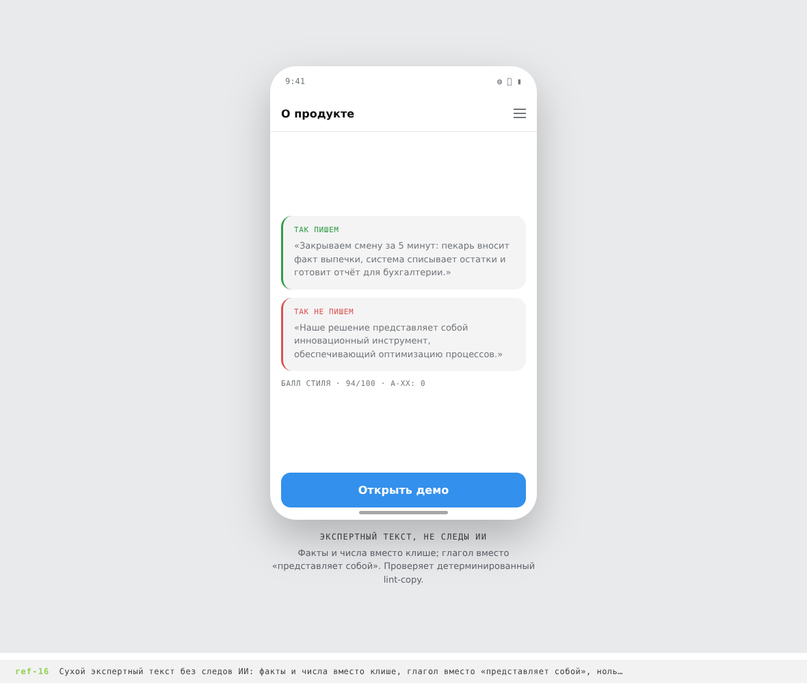

- takeaway: Сухой экспертный текст без следов ИИ: факты и числа вместо клише, глагол вместо «представляет собой», ноль артефактов копипаста (oaicite, utm_source=chatgpt.com, 【…†…】); ядро машинизируется детерминированным сканом scripts/lint-copy.mjs (коды A-xx/C-xx/N-xx/R-xx, балл 0-100; источники: smixs/humanizer-ru, ilyautov/humanizer-ru, stop-slop — MIT).
- источник: references/sources.yaml#humanizer-ru
- архетип образца: `tma-voice`
- образец: [ref-16.specimen.html](metadata/ref-16.specimen.html)
