# GALLERY — витрина архива референсов студии «Студия мобильных приложений»

Снимки собраны командой `node scripts/render_reference_screenshots.mjs` из meta.yaml:
палитра и приёмы референса → образец дизайна → PNG. Образец лежит рядом (`<id>.specimen.html`).

## ref-01 · thumb-zone

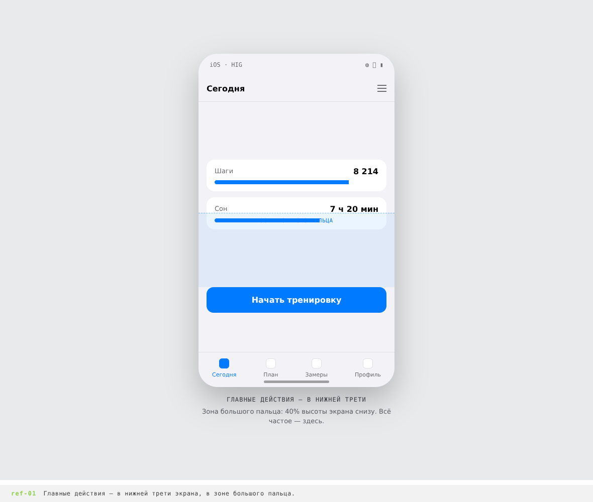

- takeaway: Главные действия — в нижней трети экрана, в зоне большого пальца.
- источник: references/sources.yaml#screen-composer
- архетип образца: `mob-thumb-zone`
- образец: [ref-01.specimen.html](metadata/ref-01.specimen.html)

## ref-02 · platform-nav

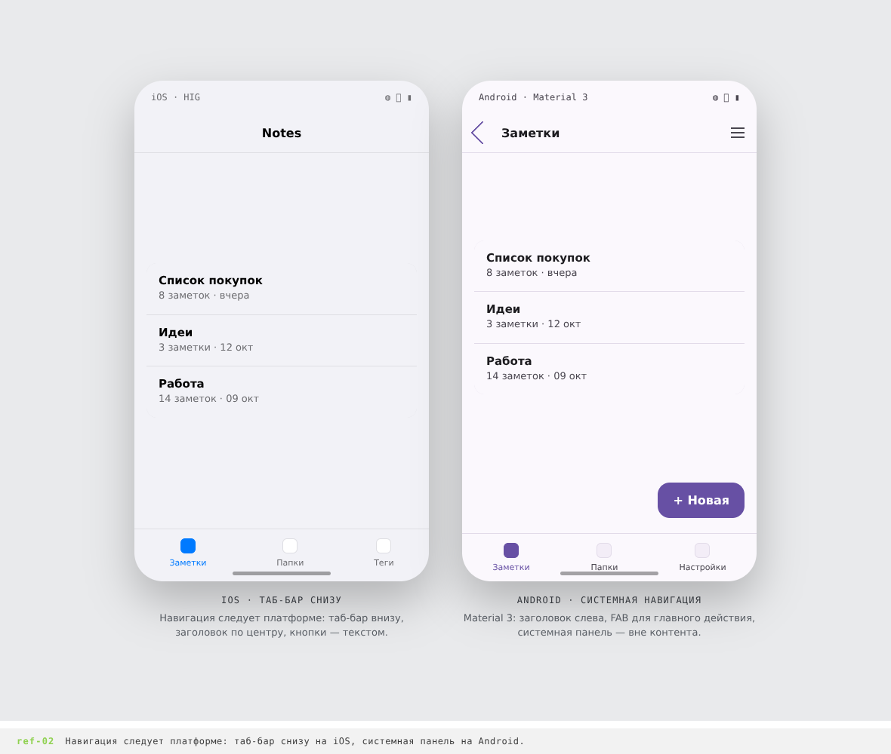

- takeaway: Навигация следует платформе: таб-бар снизу на iOS, системная панель на Android.
- источник: references/sources.yaml#screen-composer
- архетип образца: `mob-platform-nav`
- образец: [ref-02.specimen.html](metadata/ref-02.specimen.html)

## ref-03 · touch-target

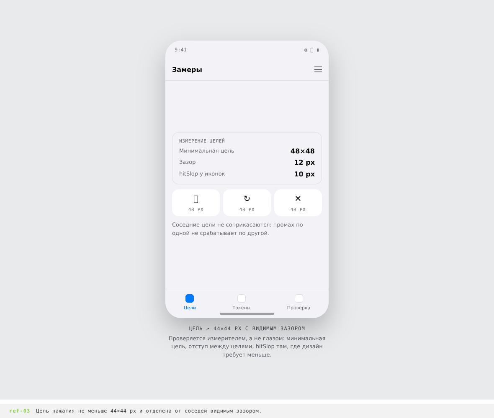

- takeaway: Цель нажатия не меньше 44×44 px и отделена от соседей видимым зазором.
- источник: references/sources.yaml#a11y-pass
- архетип образца: `mob-touch-target`
- образец: [ref-03.specimen.html](metadata/ref-03.specimen.html)

## ref-04 · offline-cache

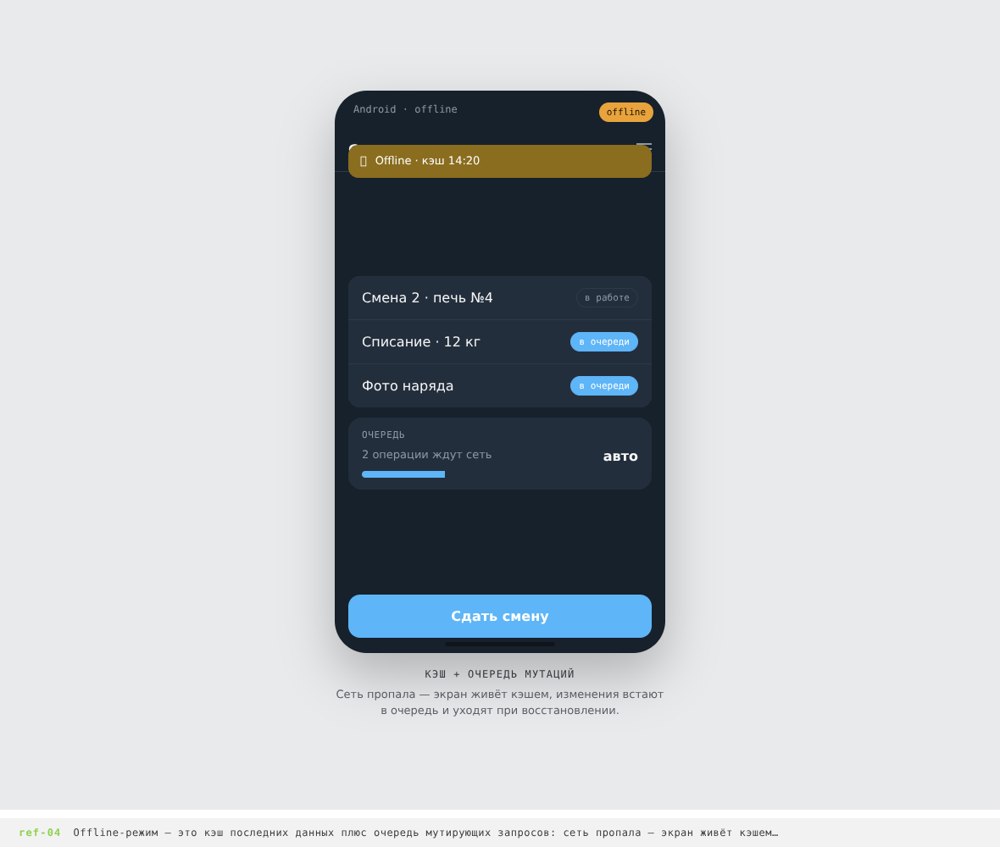

- takeaway: Offline-режим — это кэш последних данных плюс очередь мутирующих запросов: сеть пропала — экран живёт кэшем, запросы встают в очередь и уходят при восстановлении (К-07, К-17).
- источник: references/sources.yaml#offline-queue
- архетип образца: `mob-offline-queue`
- образец: [ref-04.specimen.html](metadata/ref-04.specimen.html)

## ref-05 · store-assets

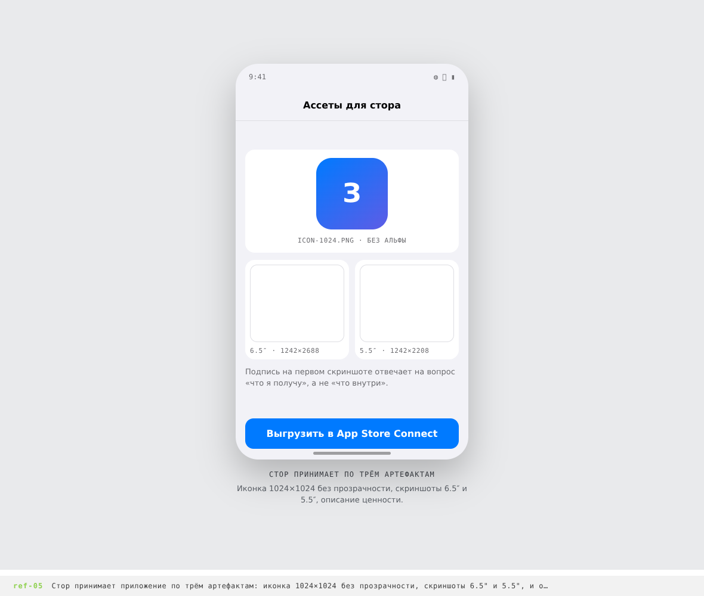

- takeaway: Стор принимает приложение по трём артефактам: иконка 1024×1024 без прозрачности, скриншоты 6.5" и 5.5", и описание ценности для пользователя (К-20).
- источник: references/sources.yaml#store-release
- архетип образца: `mob-store-assets`
- образец: [ref-05.specimen.html](metadata/ref-05.specimen.html)

## ref-06 · i18n-keys

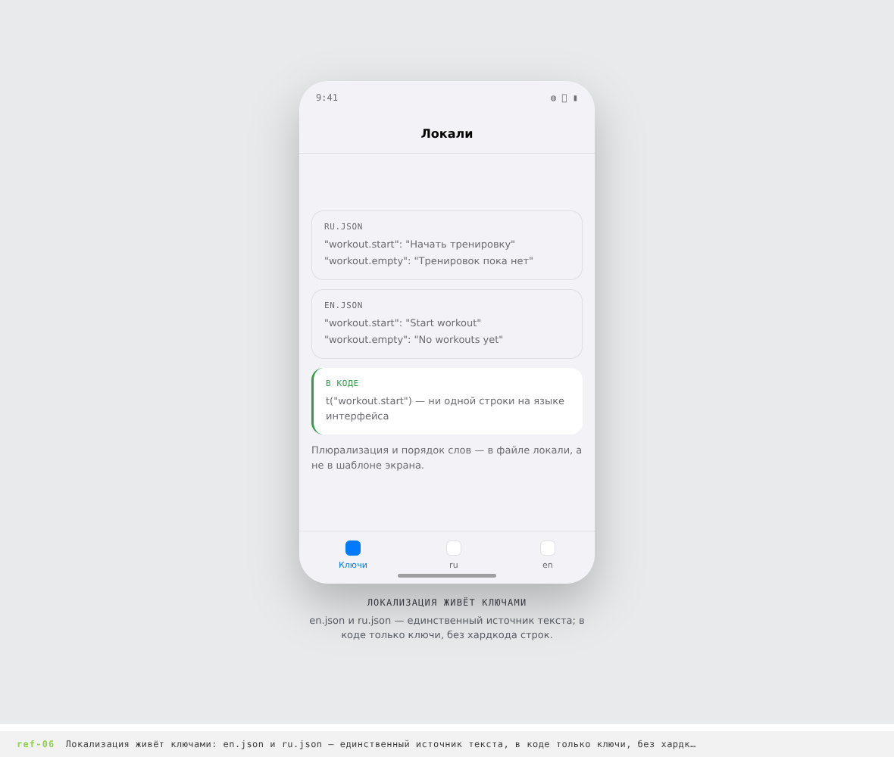

- takeaway: Локализация живёт ключами: en.json и ru.json — единственный источник текста, в коде только ключи, без хардкода строк (К-14, B-04).
- источник: references/sources.yaml#i18n-pass
- архетип образца: `mob-i18n-keys`
- образец: [ref-06.specimen.html](metadata/ref-06.specimen.html)

## ref-07 · flow-real-apps

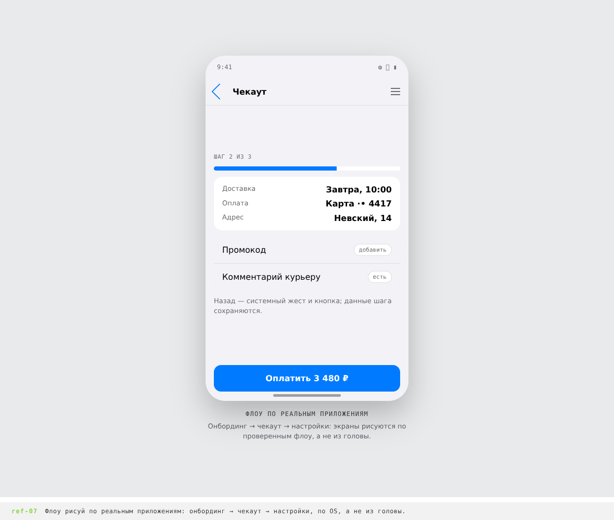

- takeaway: Флоу рисуй по реальным приложениям: онбординг → чекаут → настройки, по OS, а не из головы.
- источник: references/sources.yaml#mobbin-flows
- архетип образца: `mob-flows`
- образец: [ref-07.specimen.html](metadata/ref-07.specimen.html)

## ref-08 · pattern-library

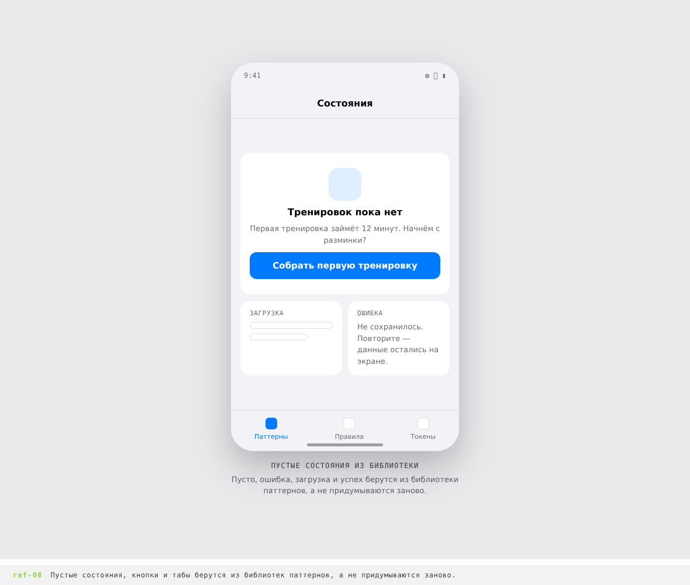

- takeaway: Пустые состояния, кнопки и табы берутся из библиотек паттернов, а не придумываются заново.
- источник: references/sources.yaml#pttrns
- архетип образца: `mob-pattern-library`
- образец: [ref-08.specimen.html](metadata/ref-08.specimen.html)

## ref-09 · platform-lang

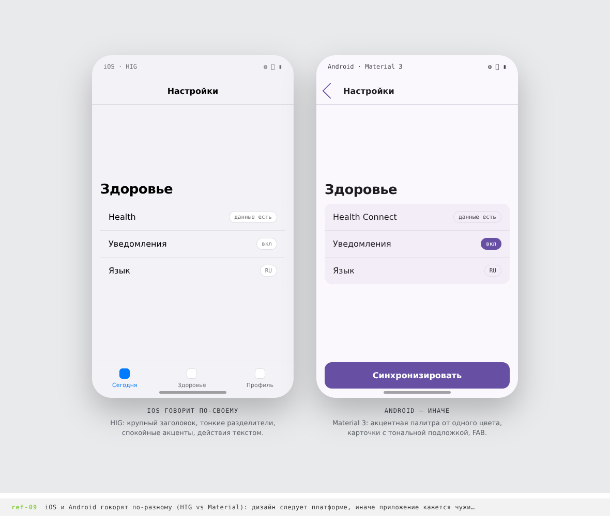

- takeaway: iOS и Android говорят по-разному (HIG vs Material): дизайн следует платформе, иначе приложение кажется чужим.
- источник: references/sources.yaml#mobile-patterns
- архетип образца: `mob-platform-lang`
- образец: [ref-09.specimen.html](metadata/ref-09.specimen.html)

## ref-10 · store-preview

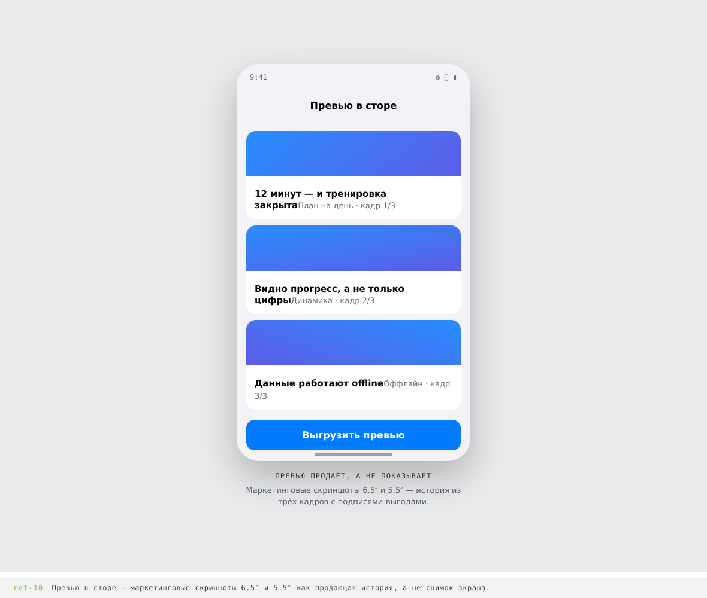

- takeaway: Превью в сторе — маркетинговые скриншоты 6.5″ и 5.5″ как продающая история, а не снимок экрана.
- источник: references/sources.yaml#scrnshts
- архетип образца: `mob-store-preview`
- образец: [ref-10.specimen.html](metadata/ref-10.specimen.html)

## ref-11 · nav-patterns

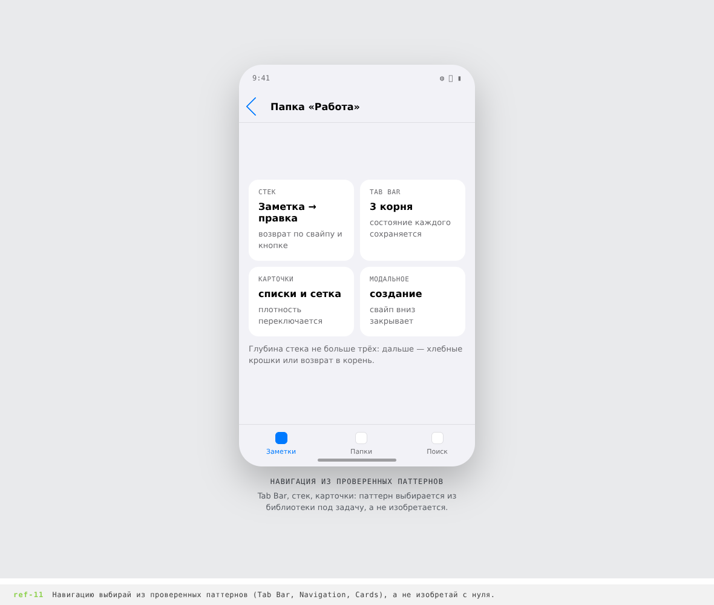

- takeaway: Навигацию выбирай из проверенных паттернов (Tab Bar, Navigation, Cards), а не изобретай с нуля.
- источник: references/sources.yaml#uigarage
- архетип образца: `mob-nav-patterns`
- образец: [ref-11.specimen.html](metadata/ref-11.specimen.html)

## ref-12 · mobile-components

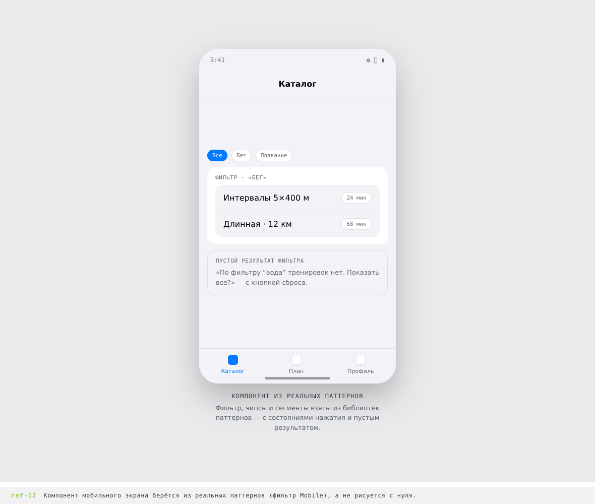

- takeaway: Компонент мобильного экрана берётся из реальных паттернов (фильтр Mobile), а не рисуется с нуля.
- источник: references/sources.yaml#collectui-mobile
- архетип образца: `mob-components`
- образец: [ref-12.specimen.html](metadata/ref-12.specimen.html)

## ref-13 · contrast-ratio

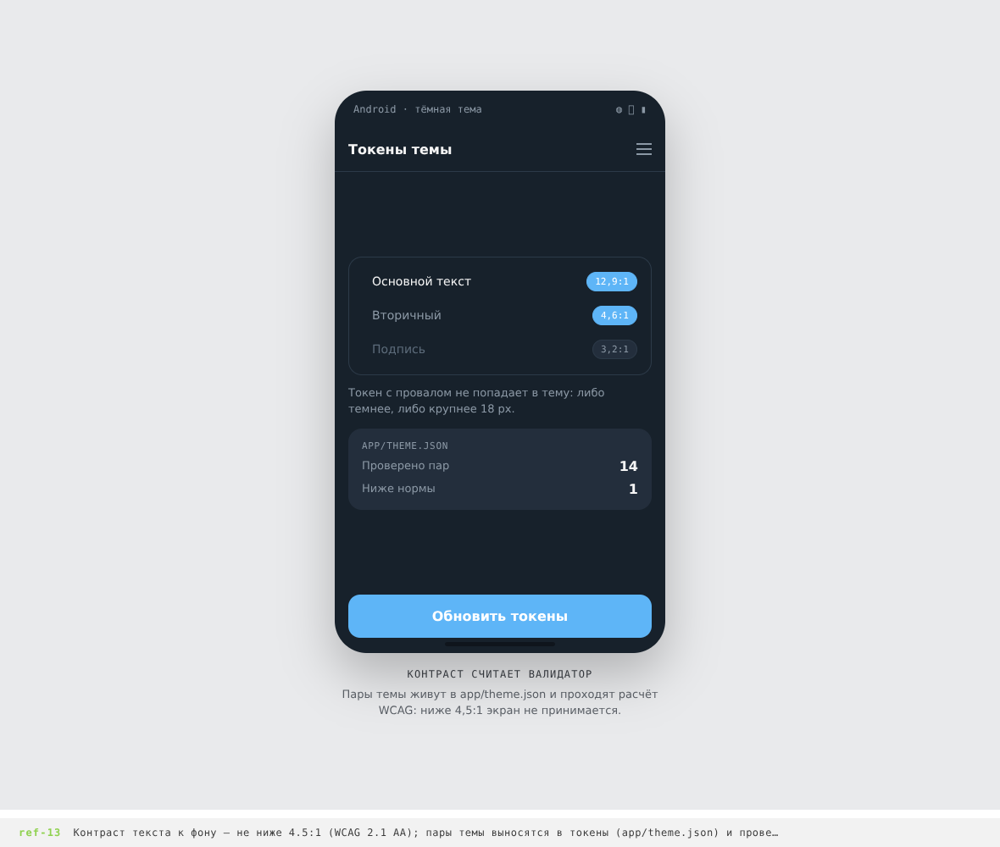

- takeaway: Контраст текста к фону — не ниже 4.5:1 (WCAG 2.1 AA); пары темы выносятся в токены (app/theme.json) и проверяются расчётом, а не глазами.
- источник: references/sources.yaml#a11y-pass
- архетип образца: `mob-contrast`
- образец: [ref-13.specimen.html](metadata/ref-13.specimen.html)

## ref-14 · usability-heuristics

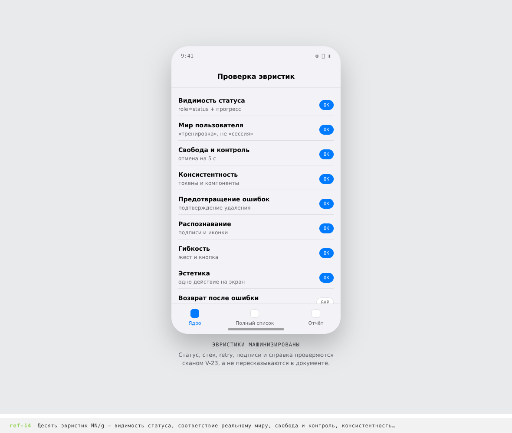

- takeaway: Десять эвристик NN/g — видимость статуса, соответствие реальному миру, свобода и контроль, консистентность, предотвращение ошибок, распознавание вместо припоминания, гибкость, эстетика, восстановление после ошибки, справка; проверяемое ядро (статус/стек/retry/подписи/справка) машинизируется прокси-сканом V-23.
- источник: references/sources.yaml#nng-heuristics
- архетип образца: `mob-heuristics`
- образец: [ref-14.specimen.html](metadata/ref-14.specimen.html)

## ref-15 · typography-pass

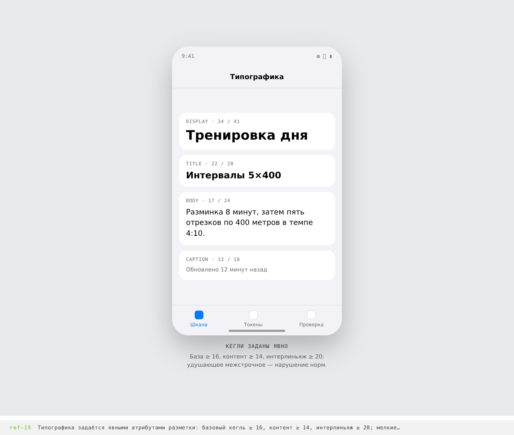

- takeaway: Типографика задаётся явными атрибутами разметки: базовый кегль ≥ 16, контент ≥ 14, интерлиньяж ≥ 20; мелкие кегли и удушающее межстрочное — нарушение норм (V-24).
- источник: references/sources.yaml#material-typography
- архетип образца: `mob-typography`
- образец: [ref-15.specimen.html](metadata/ref-15.specimen.html)

## ref-16 · animation-pass

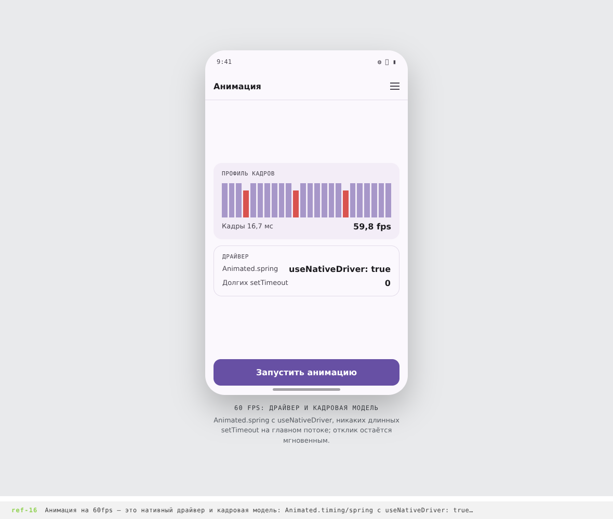

- takeaway: Анимация на 60fps — это нативный драйвер и кадровая модель: Animated.timing/spring с useNativeDriver: true, requestAnimationFrame/Easing; длинные setTimeout на главном потоке оборачиваются тормозами (V-25).
- источник: references/sources.yaml#rn-animations
- архетип образца: `mob-animation`
- образец: [ref-16.specimen.html](metadata/ref-16.specimen.html)

## ref-17 · human-voice

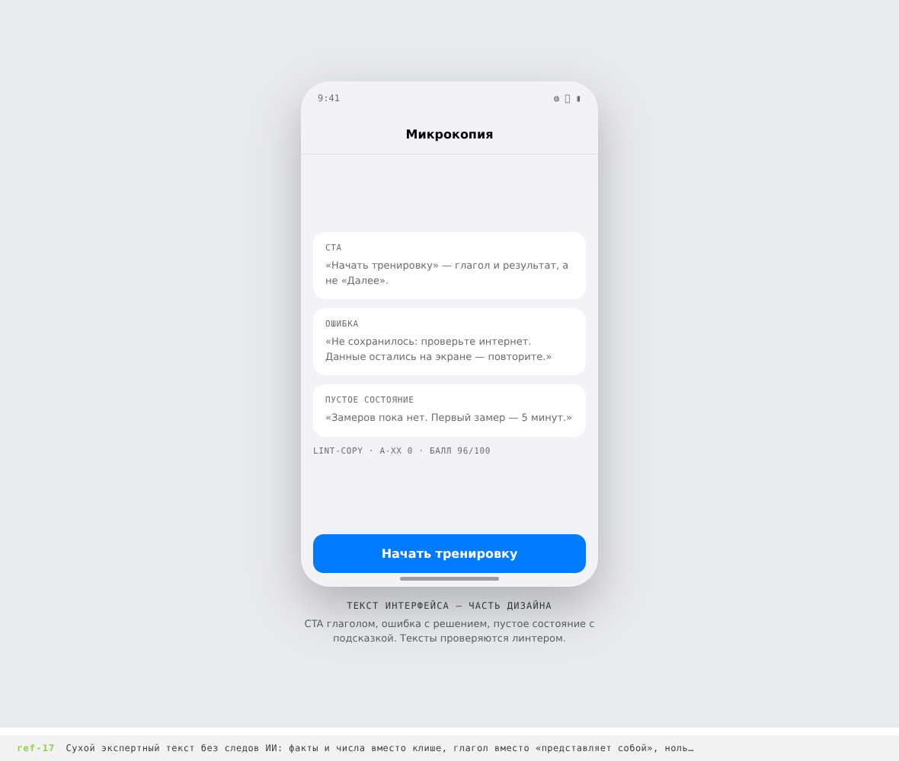

- takeaway: Сухой экспертный текст без следов ИИ: факты и числа вместо клише, глагол вместо «представляет собой», ноль артефактов копипаста (oaicite, utm_source=chatgpt.com, 【…†…】); ядро машинизируется детерминированным сканом scripts/lint-copy.mjs (коды A-xx/C-xx/N-xx/R-xx, балл 0-100; источники: smixs/humanizer-ru, ilyautov/humanizer-ru, stop-slop — MIT).
- источник: references/sources.yaml#humanizer-ru
- архетип образца: `mob-voice`
- образец: [ref-17.specimen.html](metadata/ref-17.specimen.html)
