# GALLERY — витрина архива референсов студии «Веб-студия ЦЕХ»

Снимки собраны командой `node scripts/render_reference_screenshots.mjs` из meta.yaml:
палитра и приёмы референса → образец дизайна → PNG. Образец лежит рядом (`<id>.specimen.html`).

## REF-01 · scroll-story, editorial

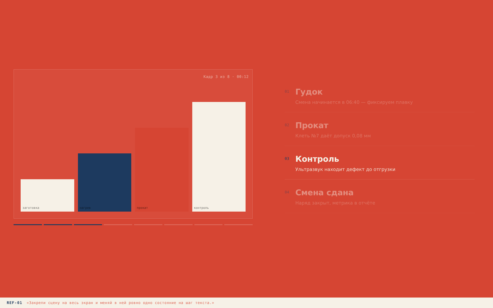

- takeaway: «Закрепи сцену на весь экран и меняй в ней ровно одно состояние на шаг текста.»
- источник: https://pudding.cool
- архетип образца: `sticky-scene`
- образец: [REF-01.specimen.html](scroll-story/REF-01.specimen.html)

## REF-02 · editorial, index

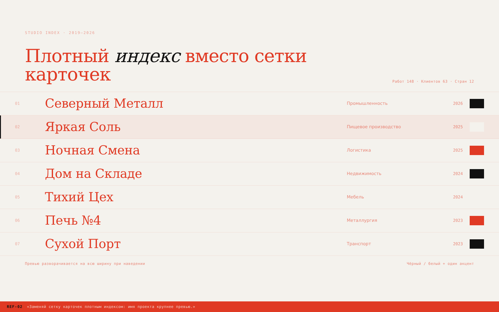

- takeaway: «Заменяй сетку карточек плотным индексом: имя проекта крупнее превью.»
- источник: https://www.pentagram.com
- архетип образца: `editorial-index`
- образец: [REF-02.specimen.html](editorial/REF-02.specimen.html)

## REF-03 · poster, illustration

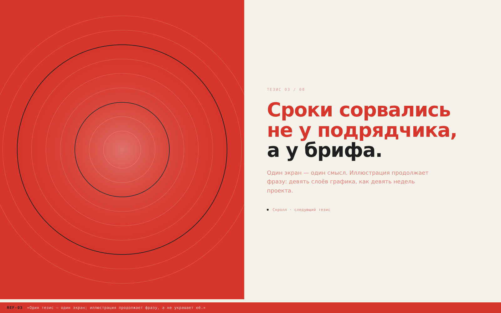

- takeaway: «Один тезис — один экран; иллюстрация продолжает фразу, а не украшает её.»
- источник: https://basecamp.com
- архетип образца: `poster-statement`
- образец: [REF-03.specimen.html](poster/REF-03.specimen.html)

## REF-04 · play, canvas

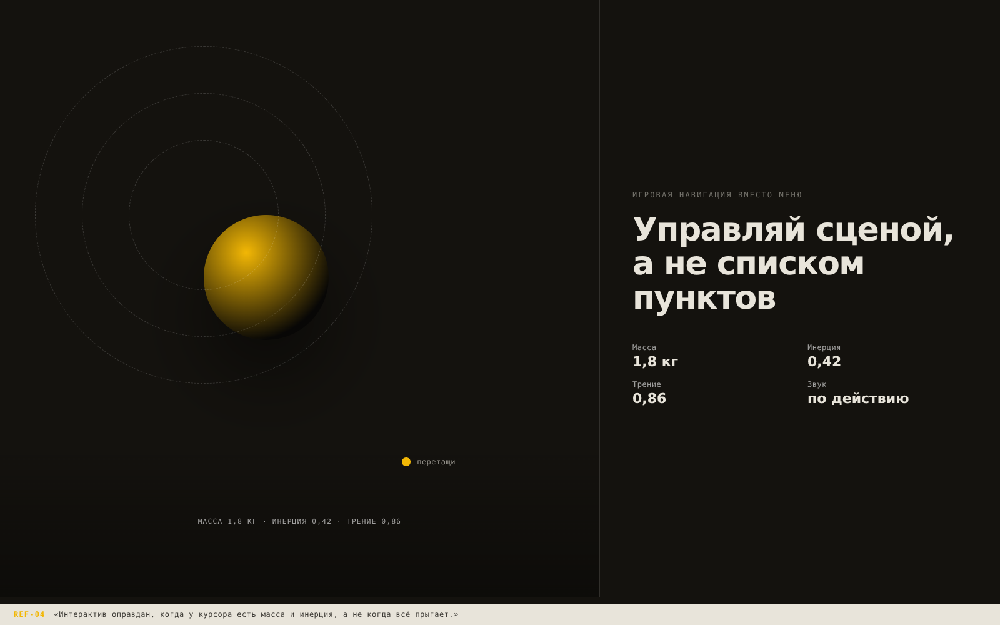

- takeaway: «Интерактив оправдан, когда у курсора есть масса и инерция, а не когда всё прыгает.»
- источник: https://bruno-simon.com
- архетип образца: `canvas-play`
- образец: [REF-04.specimen.html](play/REF-04.specimen.html)

## REF-05 · poster-type

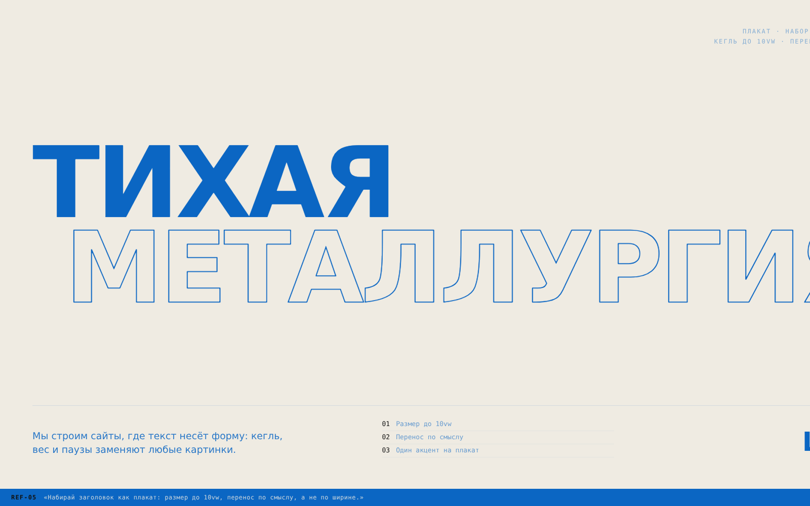

- takeaway: «Набирай заголовок как плакат: размер до 10vw, перенос по смыслу, а не по ширине.»
- источник: https://readymag.com
- архетип образца: `poster-type`
- образец: [REF-05.specimen.html](poster-type/REF-05.specimen.html)

## REF-06 · archive, ledger

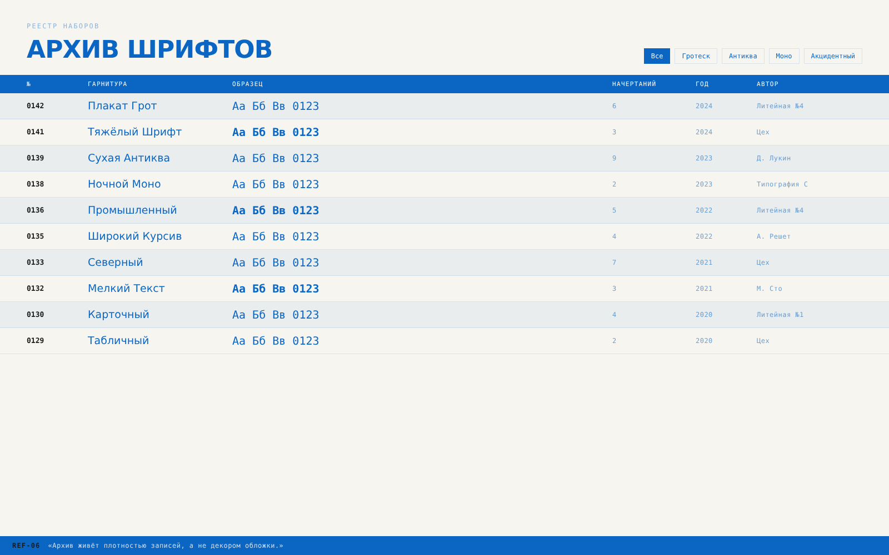

- takeaway: «Архив живёт плотностью записей, а не декором обложки.»
- источник: https://fontsinuse.com
- архетип образца: `archive-ledger`
- образец: [REF-06.specimen.html](archive/REF-06.specimen.html)

## REF-07 · industrial, poster, ledger

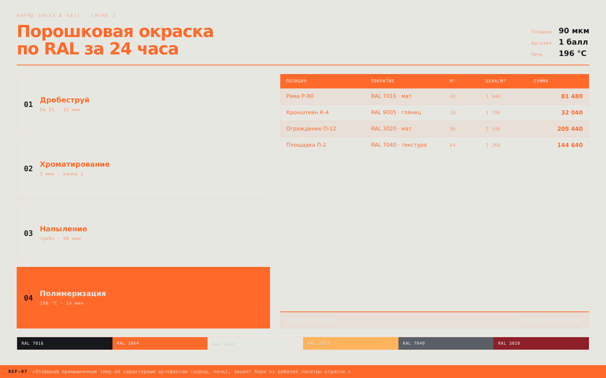

- takeaway: «Открывай промышленную тему её характерным артефактом (наряд, печь), акцент бери из рабочей палитры отрасли.»
- источник: —
- архетип образца: `industrial-passport`
- образец: [REF-07.specimen.html](industrial/REF-07.specimen.html)

## REF-08 · minimal, whitespace

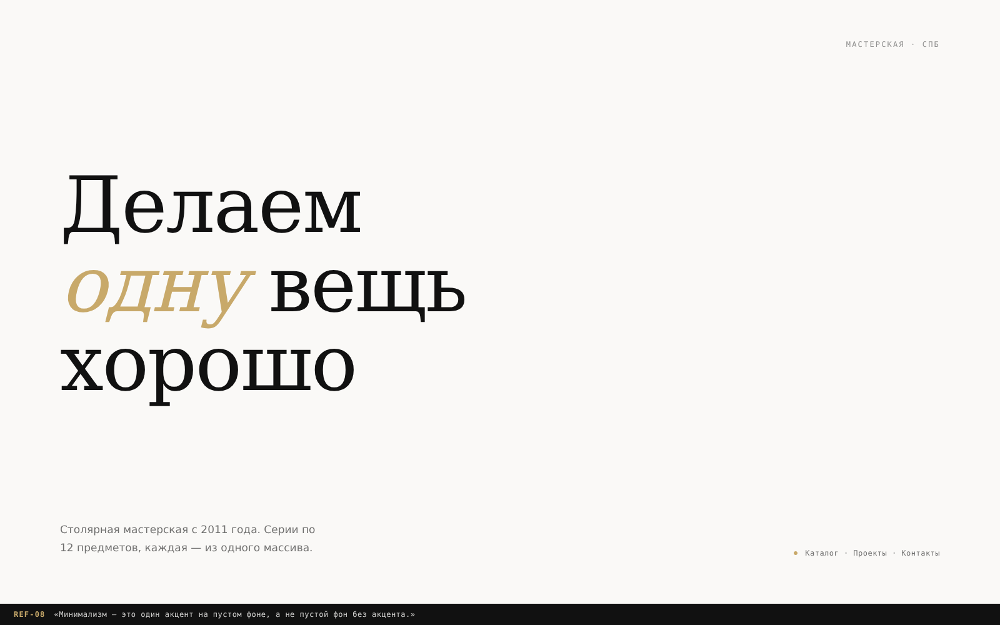

- takeaway: «Минимализм — это один акцент на пустом фоне, а не пустой фон без акцента.»
- источник: https://siteinspire.com
- архетип образца: `minimal-air`
- образец: [REF-08.specimen.html](minimal/REF-08.specimen.html)

## REF-09 · brutalist, raw

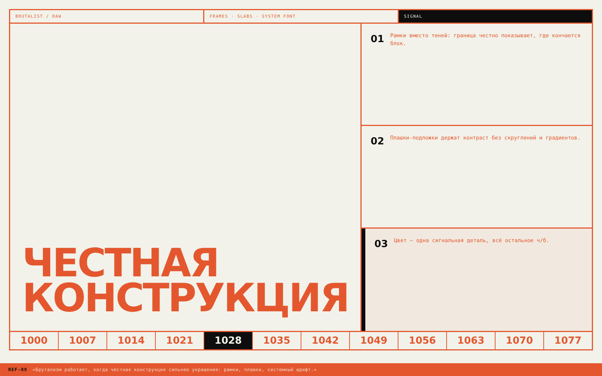

- takeaway: «Брутализм работает, когда честная конструкция сильнее украшения: рамки, плашки, системный шрифт.»
- источник: https://brutalistwebsites.com
- архетип образца: `brutalist-frames`
- образец: [REF-09.specimen.html](brutalist/REF-09.specimen.html)

## REF-10 · dark, night

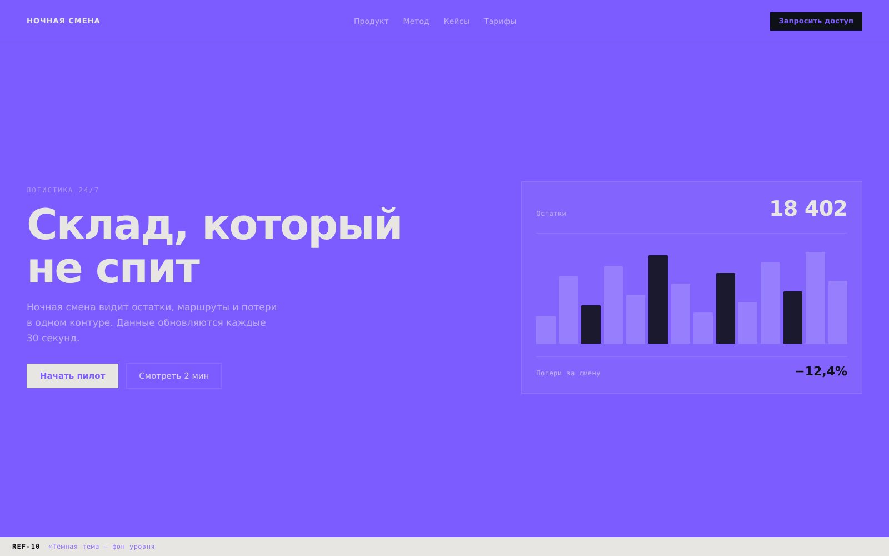

- takeaway: «Тёмная тема — фон уровня
- источник: https://darkmodedesign.com
- архетип образца: `dark-hero`
- образец: [REF-10.specimen.html](dark/REF-10.specimen.html)

## REF-11 · catalog, ecommerce, cards

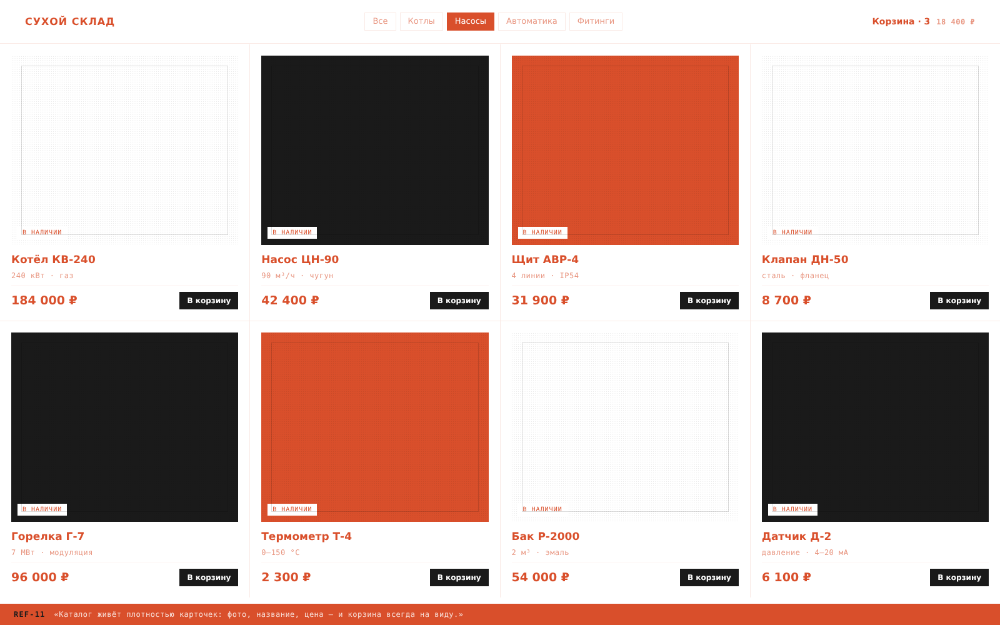

- takeaway: «Каталог живёт плотностью карточек: фото, название, цена — и корзина всегда на виду.»
- источник: https://ecommercetemplates.com
- архетип образца: `catalog-grid`
- образец: [REF-11.specimen.html](ecommerce/REF-11.specimen.html)

## REF-12 · saas, landing, conversion

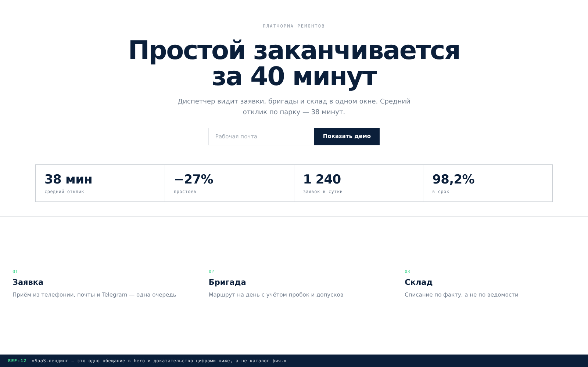

- takeaway: «SaaS-лендинг — это одно обещание в hero и доказательство цифрами ниже, а не каталог фич.»
- источник: https://saaslandingpage.com
- архетип образца: `saas-landing`
- образец: [REF-12.specimen.html](saas/REF-12.specimen.html)

## REF-13 · typography, poster

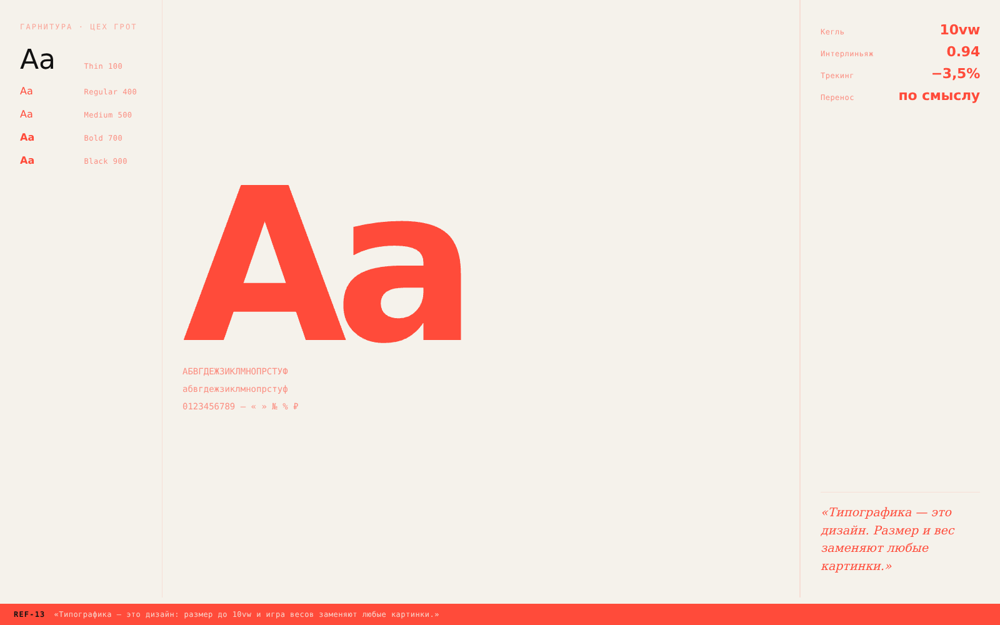

- takeaway: «Типографика — это дизайн: размер до 10vw и игра весов заменяют любые картинки.»
- источник: https://httpster.net
- архетип образца: `type-specimen`
- образец: [REF-13.specimen.html](typography/REF-13.specimen.html)

## REF-14 · animation, scroll

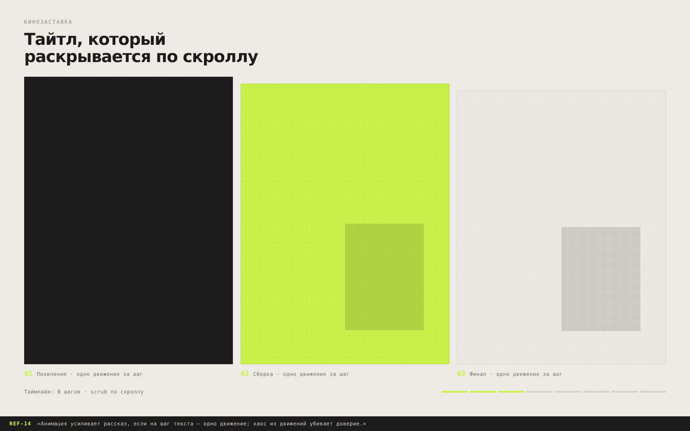

- takeaway: «Анимация усиливает рассказ, если на шаг текста — одно движение; хаос из движений убивает доверие.»
- источник: https://godly.website
- архетип образца: `scroll-cinema`
- образец: [REF-14.specimen.html](animated/REF-14.specimen.html)

## REF-15 · ui-patterns, components

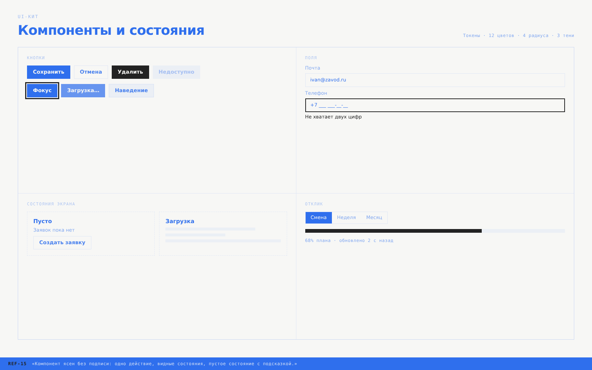

- takeaway: «Компонент ясен без подписи: одно действие, видные состояния, пустое состояние с подсказкой.»
- источник: https://collectui.com
- архетип образца: `components-sheet`
- образец: [REF-15.specimen.html](ui-patterns/REF-15.specimen.html)

## REF-16 · landing, fullpage

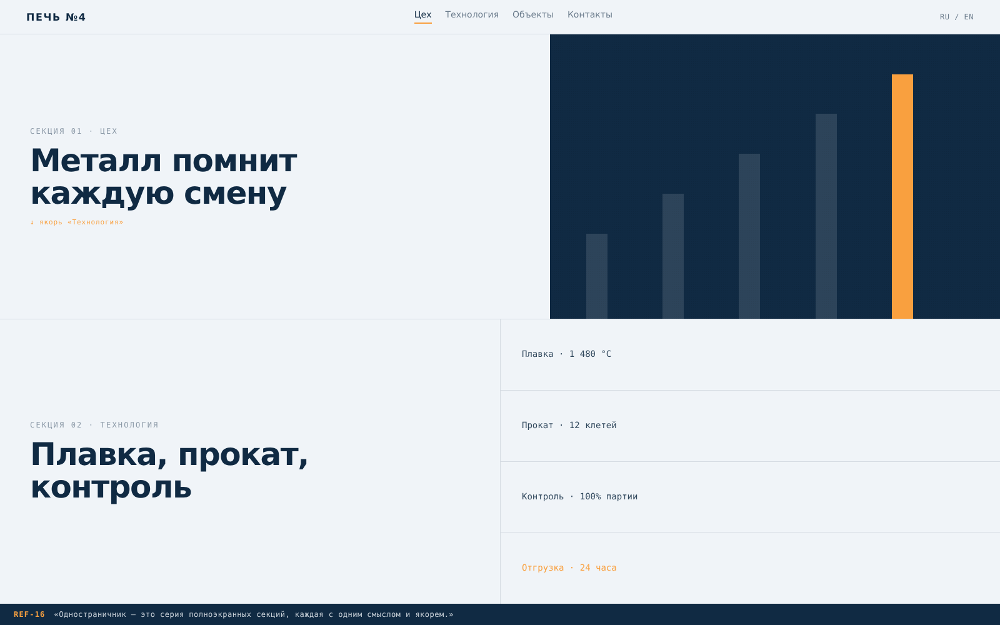

- takeaway: «Одностраничник — это серия полноэкранных секций, каждая с одним смыслом и якорем.»
- источник: https://land-book.com
- архетип образца: `fullpage-sections`
- образец: [REF-16.specimen.html](landing/REF-16.specimen.html)

## REF-17 · concept, poster

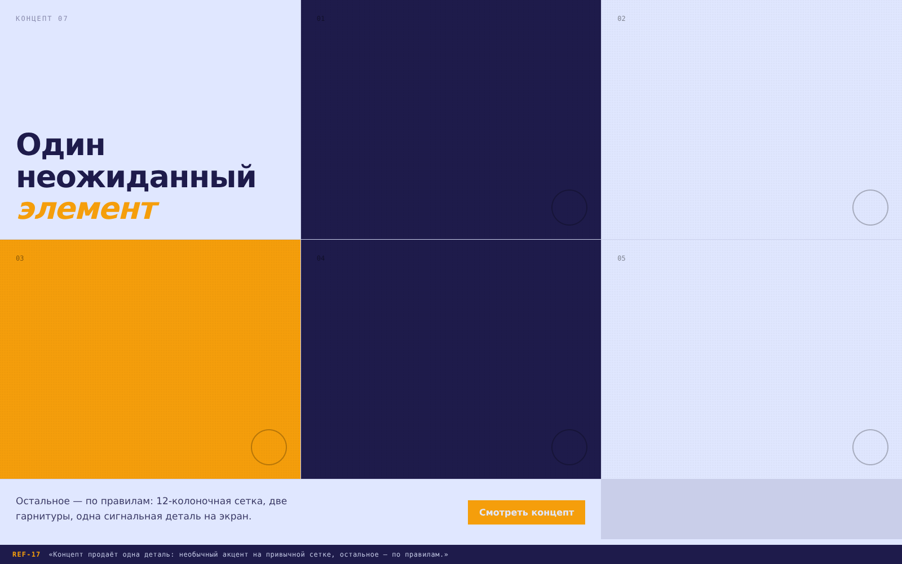

- takeaway: «Концепт продаёт одна деталь: необычный акцент на привычной сетке, остальное — по правилам.»
- источник: https://dribbble.com
- архетип образца: `concept-grid`
- образец: [REF-17.specimen.html](concept/REF-17.specimen.html)

## REF-18 · case, portfolio

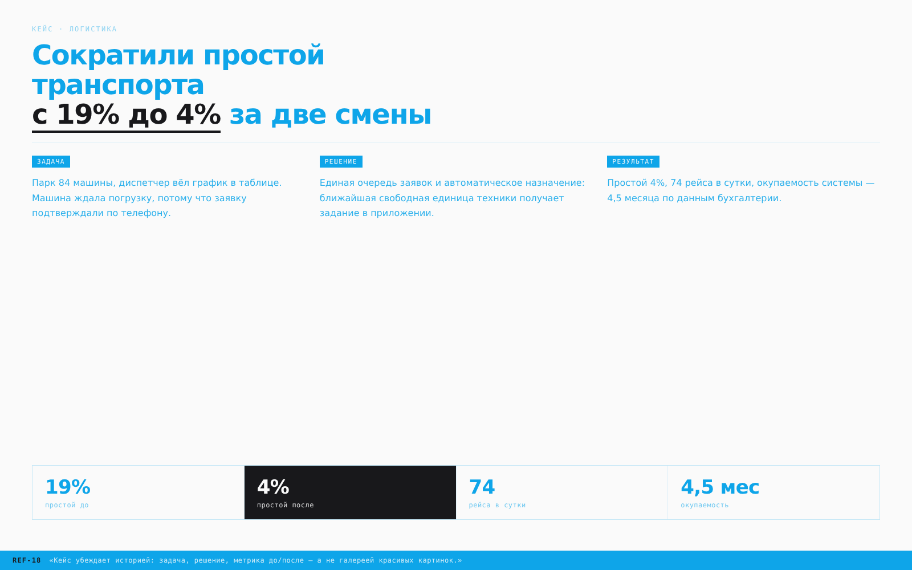

- takeaway: «Кейс убеждает историей: задача, решение, метрика до/после — а не галереей красивых картинок.»
- источник: https://behance.net
- архетип образца: `case-story`
- образец: [REF-18.specimen.html](case/REF-18.specimen.html)

## REF-19 · premium, refined

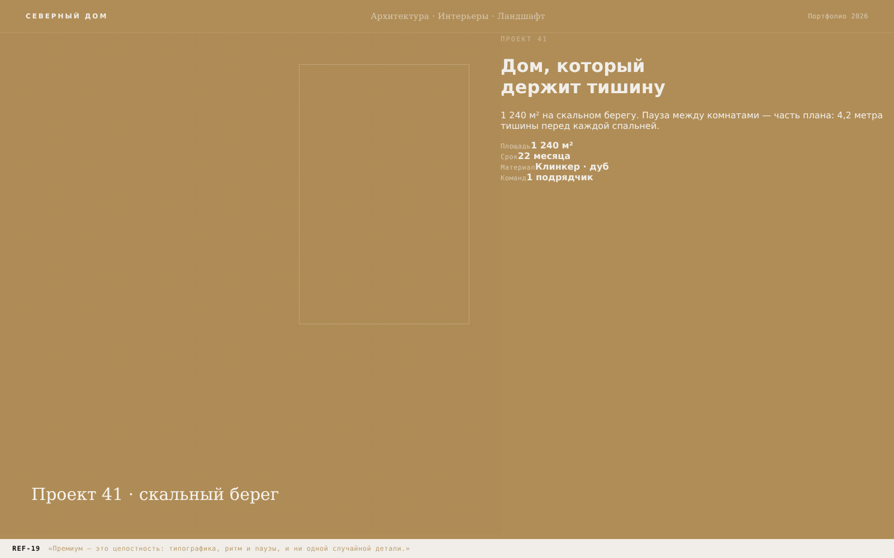

- takeaway: «Премиум — это целостность: типографика, ритм и паузы, и ни одной случайной детали.»
- источник: https://awwwards.com
- архетип образца: `premium-refined`
- образец: [REF-19.specimen.html](premium/REF-19.specimen.html)

## REF-20 · usability, heuristics

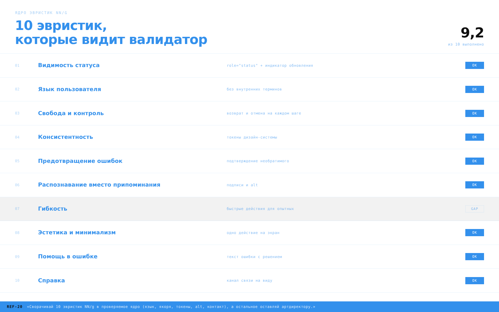

- takeaway: «Сворачивай 10 эвристик NN/g в проверяемое ядро (язык, якоря, токены, alt, контакт), а остальное оставляй артдиректору.»
- источник: nngroup.com
- архетип образца: `heuristics-core`
- образец: [REF-20.specimen.html](usability/REF-20.specimen.html)

## REF-21 · forms, conversion

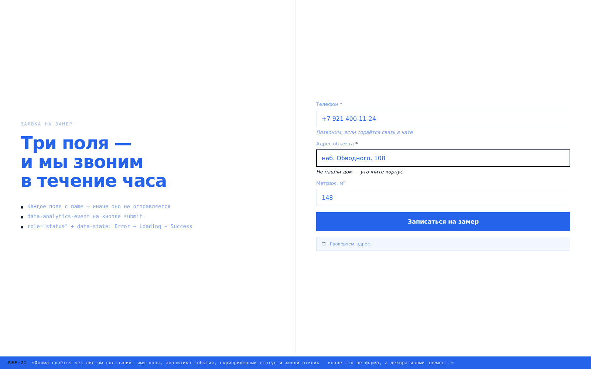

- takeaway: «Форма сдаётся чек-листом состояний: имя поля, аналитика события, скринридерный статус и живой отклик — иначе это не форма, а декоративный элемент.»
- источник: baymard.com/form-design
- архетип образца: `form-states`
- образец: [REF-21.specimen.html](forms/REF-21.specimen.html)
